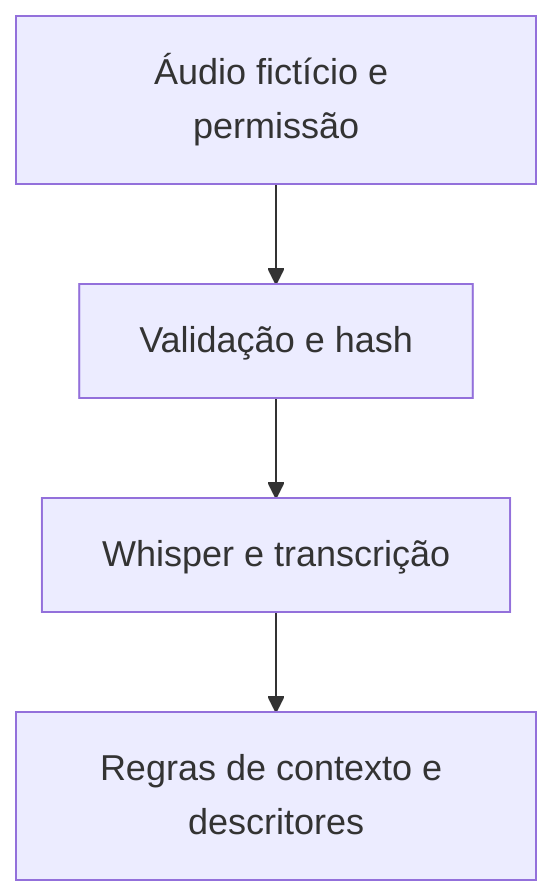
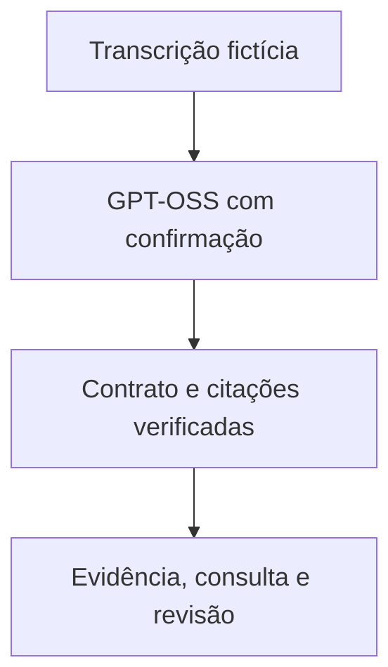
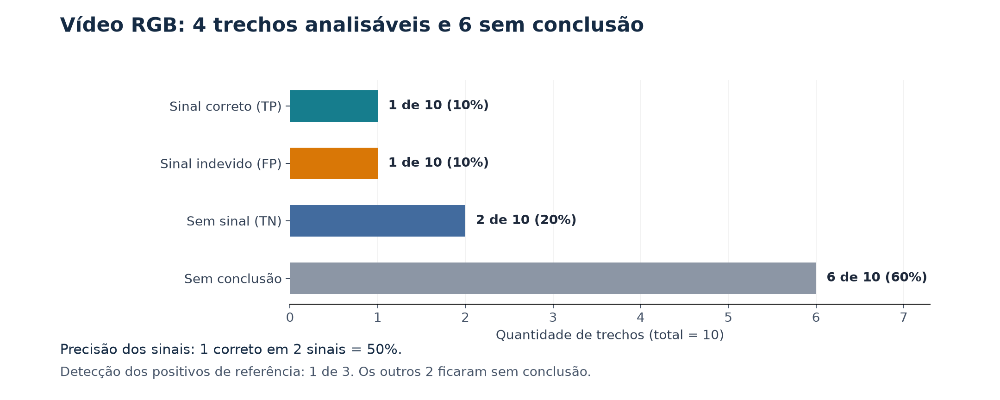
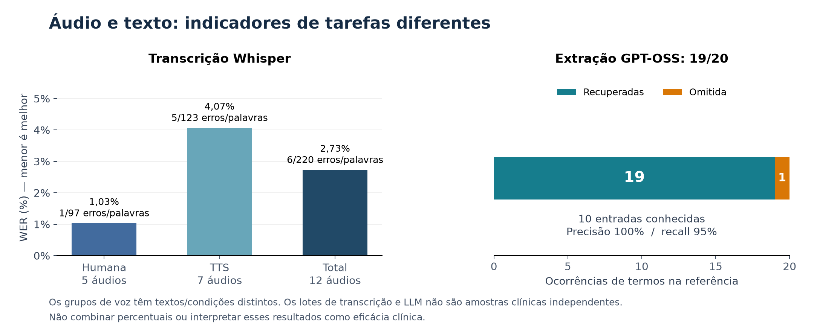

# MedAssistMultimodal
## Relatório técnico
### Prova de conceito de apoio à revisão profissional de dados multimodais

**Curso:** FIAP — Tech Challenge, Fase 4.  
**Autor:** Ari Monteiro.  
**Turma:** 9IADT.  
**Identificação acadêmica:** RM 371705.  
**E-mail:** ari_mont@yahoo.com.br.  
**Data de entrega:** 17/11/2026.  
**Repositório do projeto:** [GitHub](https://github.com/dharmasistemas/MedAssistMultimodal) — versão final na branch `main`.  
**Vídeo demonstrativo:** [YouTube](https://youtu.be/LkcmBPmCIVY).

## Resumo

O MedAssistMultimodal é uma prova de conceito acadêmica que organiza resultados de vídeo, áudio/texto e dados estruturados para revisão profissional. A solução utiliza OpenCV e MediaPipe Pose no vídeo, Whisper local na transcrição, GPT-OSS via Ollama como análise textual opcional, regras determinísticas em sinais vitais e prescrições, SQLite e interface CustomTkinter/ttk. O sistema não diagnostica, não prescreve e não substitui avaliação clínica.

A interface reúne consulta, processamento por modalidade, revisão auditada e exportação TXT/JSON. As fontes permanecem independentes: participante do dataset, locutores e paciente fictício não são a mesma pessoa. A consolidação não demonstra correlação causal nem sincronização clínica entre essas fontes.

O corpus de 12 áudios apresentou WER agregado de 2,73%. GPT-OSS com prompt revisado produziu dez análises válidas e recuperou 19 de 20 ocorrências de termos. Um conjunto textual contrastante posterior apresentou seis sentimentos coincidentes com as referências e sete ocorrências recuperadas. No vídeo, quatro de dez trechos RGB foram analisáveis pelo perfil experimental, com um verdadeiro positivo, um falso positivo e seis abstenções no conjunto. Vitais e prescrições apresentaram conformidade com referências sintéticas conhecidas. O piloto acústico não demonstrou identificação de condição médica. Esses resultados sustentam os fluxos nos recortes avaliados, sem comprovar generalização ou uso clínico.

**Palavras-chave:** análise multimodal; reabilitação; transcrição; regras experimentais; revisão humana; rastreabilidade.

## 1. Problema, objetivos e limites

O acompanhamento em saúde pode envolver movimentos registrados em vídeo, relatos falados, medidas numéricas e versões de prescrições. A proposta é facilitar a inspeção desses materiais e indicar resultados que merecem conferência, preservando origem, instante e evidência.

O objetivo geral é implementar um assistente médico de IA multimodal de apoio à revisão profissional. Os objetivos específicos são extrair informações de movimento, transcrever relatos fictícios, identificar termos com contexto, aplicar regras a vitais, comparar prescrições com expectativa declarada e registrar a revisão com auditoria.

Um termo como “dor” pode ocorrer em negação, relato histórico ou fala sobre terceiros. Uma medida fora do limiar experimental não comprova doença, e uma diferença de prescrição não determina segurança terapêutica. O aplicativo distingue resultados técnicos e candidatos para conferência, preserva abstenções e permite revisão humana dos itens de caráter clínico. PAT-001 identifica um contexto sintético, não o participante do vídeo ou os locutores nos áudios.

## 2. Escopo e substituições tecnológicas

A interface final possui quatro abas: Vídeo, Áudio e texto, Anomalias e Revisão e relatório. As modalidades podem ser demonstradas separadamente. A exportação reúne resultados selecionados e suas fontes, sem gerar uma conclusão clínica multimodal única.

Conforme a comunicação acadêmica fornecida pelo autor, a coordenação autorizou as alternativas tecnológicas adotadas neste projeto em mensagem de **27/10/2026** no Discord do curso e que foram mais uma vez confirmadas pelo professor na aula online de **06/11/2026**. No lugar de **Azure Speech to Text** foi adotado o modelo **Whisper** para transcrição de áudio para texto. No lugar de **Azure Text Analytics** foi adota do modelo **GPT-OSS 120b:cloud** via Ollama. Também foi testado o modelo **qwen2.5:7b-instruct**. Para o processamento de vídeo foram utilizadas as bibliotecas **OpenCV** e **Media Pipe Pose**. [R1]

A autorização de tecnologia não comprova atendimento de cada requisito; a seção 8 apresenta o estado de aderência.

## 3. Dados, proveniência e permissões

| Material | Uso efetivo | Limite de interpretação |
| --- | --- | --- |
| REHAB26-ViewAngles | Uma gravação RGB Ex1/cam1 e subconjunto NPY; dez trechos RGB na avaliação de cotovelo | Seleção conhecida de desenvolvimento |
| Corpus de áudio PT-BR | 12 arquivos: cinco com voz do autor e sete TTS | Relatos fictícios, roteiros repetidos e condições diferentes |
| Piloto acústico | Três arquivos AP01–AP03 da ElevenLabs, com escuta e referência temporal humanas | Experimento separado dos 12 áudios, sem comprovação médica |
| Contraste de sentimento | Seis textos fictícios com referências aprovadas | Não são novos áudios ou transcrições Whisper |
| Vitais sintéticos | 18 cenários, 216 amostras, unidades, qualidade e referências | Ocorrências construídas para verificar regras |
| Prescrições sintéticas | Comparações de versões e oito casos com plano declarado | Não representam prescrições reais ou recomendações |

Ex1 corresponde à abdução do braço direito. A página do [REHAB26 no Zenodo](https://zenodo.org/records/23018128) documenta origem e condições de uso acadêmico/não comercial. O projeto mantém manifestos e hashes e não distribui o vídeo do dataset no Git. A atribuição deve acompanhar o uso conforme as condições da fonte. [R2]

Os cinco áudios humanos usam a voz do autor, com autorização registrada. Os sete TTS principais foram obtidos no Dark Planner Pro com vozes da ElevenLabs. O retorno do suporte em 06/11, transcrito pelo autor, autorizou o uso solicitado. Essa comunicação não foi convertida em alegação de domínio público ou licença irrestrita. O piloto posterior usa a voz Fernanda, com modelo informado como Eleven v4 e configurações registradas. [R3]

O autor conferiu as referências de transcrição. A09 não inclui um artigo inicial identificável; A11 não inclui o pronome inicial omitido. Essas diferenças foram preservadas. BIDMC e outros datasets considerados no planejamento não constituem evidência de avaliação independente nesta entrega.

## 4. Arquitetura e implementação

### 4.1. Responsabilidades

| Camada | Responsabilidade |
| --- | --- |
| Domínio | Identidades, eventos, contexto, qualidade temporal, ângulos e regras |
| Aplicação | Casos de uso, contratos tipados, evidências e revisão |
| Providers/adapters | Whisper, Ollama, vídeo e extração de pose |
| Infraestrutura | SQLite, evidência JSON, hashes, auditoria e bases de trabalho |
| Interface | CustomTkinter/ttk, worker e atualização no thread principal |
| Verificação | pytest offline, cenários sintéticos e execuções documentadas |

O ambiente usa Windows, Python 3.12 e Conda. As dependências declaradas incluem CustomTkinter 6.0.0, MediaPipe 1.2.0, OpenCV contrib 5.0.0.93, faster-whisper 1.2.1 e PyAV 14.2.0. Manifestos e requisitos registram as versões executadas; a documentação online não substitui esse registro.

A máquina informada pelo autor possui NVIDIA GeForce GTX 1050 Ti com 4 GB. Whisper executou localmente em CPU/int8, com quatro threads. Falhas de inicialização CUDA motivaram experimentos Qwen em CPU. Esse perfil era específico das chamadas do experimento, não uma configuração global obrigatória para o modelo.

### 4.2. Fluxo de áudio

**Processamento local**



**Complemento textual opcional**



O primeiro caminho funciona com LLM desativada. A opção GPT-OSS envia somente a transcrição fictícia autorizada por execução. A inferência ocorre na nuvem Ollama, mesmo quando a API é acessada por um serviço local. A LLM não decide alertas. Consultar uma análise salva não executa novamente o modelo. [R4]

Um worker realiza operações demoradas, e a interface recebe resultados por fila no thread principal. O player prepara áudio com PyAV e reproduz por backend Windows, sem chamar ASR ou LLM para apenas ouvir.

### 4.3. Persistência, integridade e horários

SQLite armazena sessões, eventos e auditorias. Os eventos preservam identidade, origem, timestamp, confiança quando disponível, referência de evidência e estado de revisão. Confiança não calculada permanece nula. O JSON original e seu hash não são reescritos ao revisar um item.

A revisão registra autoria declarada, motivo, horário e mudança de estado. Não há autenticação do revisor nesta POC. “Revisado” significa conferência registrada, não validação clínica. “Descartar com motivo” mantém a auditoria e não exclui a sessão.

Novas operações gravam em uma base de trabalho reconhecida. Bases históricas podem ser consultadas em somente leitura. Retentativas reutilizam bytes e IDs preparados; uma nova inferência gera outra execução. Evidência e SQLite não compõem uma transação distribuída: uma falha pode deixar arquivo órfão, sem sessão validamente registrada.

Em Vitais e Prescrições, o horário nominal pertence ao cenário. O registro real vem de `audit_records.created_at` da primeira gravação da sessão. A interface apresenta ambos, convertidos para o fuso local. Copiar uma sessão preserva sua data original. Ausência de auditoria é explicitada, sem inventar um instante. [R5]

## 5. Metodologia

### 5.1. Vídeo

OpenCV lê os frames; MediaPipe estima pose e permite calcular ângulos. A análise de ciclos e o desvio de cotovelo são tarefas diferentes. Landmarks NPY fornecidos pelo dataset e medidas extraídas do RGB local são fontes experimentais distintas.

No perfil de cotovelo, ângulo **inferior a 150°** conta como flexão experimental. O trecho exige cobertura mínima de 80% e pelo menos 20% dos frames válidos abaixo do limiar para sinalizar. Qualidade e ausência de pose são tratadas explicitamente. Esses valores são referências experimentais, não limiares médicos validados. [R6]

Os dez intervalos conhecidos foram fornecidos como entrada. O sistema não descobriu automaticamente todos os trechos incorretos da gravação. Um frame de evidência localiza o menor ângulo no trecho analisável; a decisão não se reduz a esse frame.

### 5.2. Transcrição e texto

Whisper usa o modelo small multilíngue convertido para CTranslate2. As referências humanas não são fornecidas ao ASR. WER é `(substituições + deleções + inserções) / palavras da referência`, com normalização documentada.

Regras distinguem afirmação, negação, condição, histórico, terceiros e incerteza, sem depender da LLM. O contrato v3 exige termo canônico e citação literal verificável; posições são calculadas pelo código. O prompt v2 é versionado separadamente. Uma resposta rejeitada não é pontuada parcialmente como análise válida.

Sentimento descreve a avaliação linguística do relato, não condição médica: dor pode coexistir com avaliação positiva do atendimento, e ausência de dor não determina sentimento positivo. [R4, R7]

### 5.3. Acústica, vitais e prescrições

Os descritores acústicos incluem RMS, pico, duração e intervalos de baixa energia. O piloto procura pausas internas frequentes com regras fixas. Referência qualitativa e marcação temporal são tarefas distintas; o protocolo temporal usa IoU mínima de 0,5. Os áudios e rótulos não foram alterados para obter resultado positivo. [R8]

Vitais preservam unidade, timestamp e qualidade, sem substituir ausências por zero. Em V02, cinco amostras de FC de 120 bpm excedem o limite superior experimental de 110 bpm; a regra exige três amostras válidas consecutivas. Isso verifica software, não define urgência. [R9]

Prescrições comparam o observado com plano sintético independente, aplicável à identidade, base, versão e intervalo nominal. Os estados são compatível, divergente ou indeterminado; apenas divergência gera candidato. Unidades incompatíveis não são convertidas para concluir equivalência terapêutica. Em E02, anterior 10 mg, esperado 15 mg e observado 20 mg têm papéis distintos: esperado vem do plano. [R10]

## 6. Resultados

As tabelas consolidam execuções já documentadas. Não foram repetidas inferências para redigir esta revisão. TP indica verdadeiro positivo, FP falso positivo e FN falso negativo. Os conjuntos são pequenos e conhecidos; não devem ser somados como pacientes independentes.

**Como interpretar os números:** WER mede erros de palavras, e valores menores indicam maior fidelidade da transcrição. Precisão mede quantos sinais positivos estavam corretos; recall mede quantos positivos de referência foram recuperados. Cobertura indica quanto do material permitiu análise. Uma abstenção é ausência de conclusão, não um resultado negativo correto. Essas medidas têm unidades e denominadores distintos, portanto não formam uma “nota geral” do sistema.


### 6.1. Vídeo RGB: cotovelo experimental

| Medida nos dez trechos | Resultado |
| --- | --- |
| Trechos analisáveis | 4/10, ou 40% |
| TP / FP / verdadeiros negativos nos analisáveis | 1 / 1 / 2 |
| Abstenções | 6, incluindo dois positivos de referência |
| Precisão entre resultados positivos analisáveis | 50% |
| Positivos detectados entre todos os positivos de referência | 1/3 |

D9-04 foi o verdadeiro positivo observado. Nos frames 897–1056, houve 160 frames válidos e 42 abaixo de 150°, fração de 26,25%. O frame 1015 apresentou mínimo de aproximadamente 135,79°. D9-02 foi falso positivo frente à referência conhecida. Resultados desfavoráveis e abstenções permaneceram na avaliação. [R6]

A qualidade não sustenta avaliação confiável de todo o exercício. Baixa visibilidade é limitação técnica, não comprovação de execução inadequada.



**Figura 1 — Cobertura e erros do detector de cotovelo.** O denominador das barras é o conjunto de dez trechos conhecidos. A precisão de 50% considera apenas os dois sinais emitidos, enquanto a recuperação global considera os três positivos de referência. Dois positivos ficaram sem conclusão. As seis abstenções não foram reclassificadas como movimentos corretos. Fonte: avaliação RGB preservada [R6].


### 6.2. Segmentação NPY separada

| Medida de segmentação NPY world 3D | Resultado |
| --- | --- |
| Frames / referências elegíveis | 15.016 / 110 |
| Ciclos pareados / FP / referências não detectadas | 34 / 0 / 76 |
| Precisão / recall / F1 | 100% / 30,91% / 47,22% |
| Cobertura braço–tronco após máscara adicional | 48,08% |

A precisão alta ocorre junto de recuperação baixa. Essas métricas de ciclos NPY não validam o detector de desvio RGB. A diferença documentada de 133 frames entre RGB e NPY, a interpretação de unidades 2D e o alinhamento visual integral permanecem limitações. [R11]

### 6.3. Whisper no corpus de 12 áudios

| Grupo | Arquivos | Erros / palavras | WER agregado |
| --- | --- | --- | --- |
| Voz humana | 5 | 1 / 97 | 1,03% |
| TTS | 7 | 5 / 123 | 4,07% |
| Total descritivo | 12 | 6 / 220 | 2,73% |

Os grupos têm textos e condições diferentes. O resultado não comprova superioridade causal da voz humana. A02/A06 repetem roteiro e apresentaram “senti” por “sente”. WER mede transcrição, não entendimento clínico ou segurança dos candidatos. [R12]

### 6.4. Seleção da LLM e revisão de prompt

| Experimento | Análises aceitas | Resultado observado |
| --- | --- | --- |
| Qwen CPU, contrato v2, lote conhecido | 4/10 | Seis rejeições de evidência |
| GPT-OSS, primeiro prompt do contrato v3 | 0/10 | Sentimento neutro sem citação exigida |
| GPT-OSS, prompt v2 do contrato v3 | 10/10 | 19 TP, zero FP e um FN por ocorrência de termo |
| Qwen com o mesmo prompt revisado, dois casos em 08/11 | 1/2 | Timeout em A03; omissão em A05 na resposta aceita |

GPT-OSS revisado apresentou precisão de 100%, recall de 95% e F1 de 97,44% por ocorrência. A04 manual omitiu a segunda menção de tontura. Sentimento coincidiu em dez entradas, todas com referência neutra. As entradas eram versões manual e Whisper de cinco relatos, não dez pacientes. [R4]

Nos dois casos adicionais com o mesmo prompt, Qwen A03 Whisper atingiu timeout em 180,026 s. A05 respondeu em 41,502 s com uma de duas ocorrências. As execuções GPT-OSS existentes encontraram duas ocorrências em cada entrada, em 1,575 s e 0,825 s. Não houve nova chamada cloud nessa comparação. Hardware, carga e recursos diferiam. Os resultados orientaram a escolha operacional do GPT-OSS, sem estabelecer superioridade universal. Os lotes Qwen com contrato anterior não constituem comparação controlada com o contrato v3. [R13]



**Figura 2 — Transcrição e extração textual medem tarefas diferentes.** À esquerda, a taxa de erros do Whisper mantém as contagens de palavras e a distinção entre vozes. À direita, o GPT-OSS recuperou 19 das 20 ocorrências de referência, com uma omissão e nenhum falso positivo. O total de 12 áudios não deve ser somado às dez entradas manual/Whisper como amostras independentes. Fontes: [R12] e [R4].

### 6.5. Sentimento em textos contrastantes

Em 12/11, seis textos fictícios foram avaliados com GPT-OSS, prompt v2/contrato v3. Houve seis respostas válidas e seis rótulos coincidentes: dois positivos, dois negativos, um misto e um neutro. Sete ocorrências de termos foram recuperadas, sem FP/FN nesse conjunto. As citações receberam conferência semântica aprovada pelo autor em 13/11. [R7]

| Sentimento de referência | Textos | Rótulos coincidentes |
| --- | --- | --- |
| Positivo | 2 | 2 |
| Negativo | 2 | 2 |
| Misto | 1 | 1 |
| Neutro | 1 | 1 |
| Unknown | Não avaliado | Não calculado |

As seis chamadas somaram 5,009 s, sem representar tempo total do processo ou garantia de latência. Unknown não foi testado. O conjunto foi escrito para contraste, com linguagem explícita; não comprova robustez a relatos clínicos ou erros de ASR.

### 6.6. Piloto acústico

| Avaliação | Resultado |
| --- | --- |
| Classificação global dos três arquivos | Todos sem sinal de pausas frequentes |
| Concordância com escuta qualitativa por arquivo | 2/3; AP03 discordante |
| Intervalos humanos de pelo menos 0,60 s | Zero nos três arquivos revisados |
| Comparação temporal | 0 TP, 1 FP e 0 FN |
| Precisão temporal | 0%, uma detecção sem correspondência |
| Recall temporal | Não calculável, sem positivos humanos |

**Ausência de positivos não demonstra sensibilidade.** As três listas temporais humanas estavam vazias para intervalos de pelo menos 0,60 s. Por isso, zero FN não pode ser interpretado como recall de 100%. O resultado temporal avalia correspondência com a marcação; a concordância qualitativa de 2/3 avalia outra pergunta, sobre pausas frequentes por arquivo.

O intervalo adicional de AP02 foi 4,38–5,20 s. Um intervalo não satisfez o perfil global de pausas frequentes. AP03 apresentou pausas curtas nos descritores, sem sinal global. Não se alteraram rótulos ou limiares para melhorar os números. Nenhuma condição médica foi demonstrada. [R8]

### 6.7. Vitais e prescrições sintéticos

| Avaliação | Resultado |
| --- | --- |
| Vitais | 18 cenários, 216 amostras; 13 TP, zero FP/FN nas referências conhecidas |
| Comparação inicial de prescrições | 24 cenários, 17 válidos e 7 rejeitados; 13 mudanças exatas |
| Prescrições com expectativa declarada | 8 casos: 1 compatível, 4 divergentes e 3 indeterminados |

As quatro divergências com plano produziram candidatos. Retentativas não duplicaram eventos nos roteiros verificados. Conformidade sintética não estabelece desempenho em prescrições ou séries clínicas reais. [R9, R10]

### 6.8. Interface, integridade e testes

A interface final mantém quatro abas, player local, frames selecionados pela tabela, detalhes técnicos recolhíveis, consultas históricas, revisão auditada e exportação consolidada. O autor informou inspeção visual dos incrementos de simplificação e aparência. [R14]

Em 15/11, a base enxuta foi preparada com oito sessões, 19 eventos e 12 auditorias, preservando IDs e estados. Os oito detalhes e a síntese conjunta foram verificados. Essas contagens descrevem o instante da preparação; novos testes podem ter acrescentado sessões. A base depende dos JSON e mídias referenciados, não sendo um pacote autônomo. [R5]

| Verificação concluída | Resultado e alcance |
| --- | --- |
| Regressão completa na preparação da distribuição, 16/11 | 1.216 testes e 341 subcasos, 66,80 s |
| Planos congelados e inicialização após checkout Git | 36 testes, 4,79 s; 341 arquivos com hashes preservados |
| Ajuste final do diagnóstico de inicialização | 2 testes, 0,19 s |
| Opacidade da janela | 8 testes específicos e reescala simulada em 100%, 150% e 125%, sem erros de callback |
| Regressão após a limpeza autorizada, 17/11 | 1.216 testes e 341 subcasos, 64,80 s; sem falhas |

A correção de monitores removeu referências de layout a botões antigos ocultados e protegeu a opacidade. O processo de teste expôs apenas um monitor; a passagem física entre as duas telas do autor não foi validada pelo assistente. [R15]

A preparação do repositório também verificou a inicialização de cinco sessões sintéticas sem o histórico privado, além da consulta pela UI, revisão e geração de síntese em testes. Rodadas anteriores com falha ou interrupção permanecem registradas e não foram contabilizadas como aprovadas; a tabela apresenta as verificações posteriores concluídas. [R17]

Quantidade de testes não representa número de pacientes ou comprovação clínica. Os testes de software e de reprodução sintética não substituem avaliação independente dos pipelines reais de mídia.

## 7. Interface e demonstração

| Aba | Percurso principal |
| --- | --- |
| Vídeo | Selecionar trecho ou resultado salvo, consultar frames/medidas e acessar revisão |
| Áudio e texto | Ouvir, transcrever localmente e consultar contexto/análise GPT-OSS opcional |
| Anomalias | Analisar ou consultar vitais e prescrições, com ocorrências e estados explícitos |
| Revisão e relatório | Consultar evidência, registrar decisão e auditoria, gerar prévia e exportar |

Selecionar entrada não altera automaticamente um resultado histórico. Consultar não reprocessa. Criar cópia de trabalho copia integralmente a base selecionada; a seleção enxuta foi preparada tecnicamente. A interface não oferece exclusão de sessões.

O vídeo segue o percurso de objetivo/tecnologias, demonstração e encerramento. O autor informou a conclusão da gravação e edição em 16/11 e acrescentou o link do YouTube ao relatório, mantido no cabeçalho. A duração e a disponibilidade para o avaliador precisam ser conferidas na plataforma; não foram aferidas nesta revisão. O audiovisual permanece fora do repositório. [R16]

## 8. Aderência aos requisitos

“Atendido no recorte” identifica uma função demonstrada no conjunto indicado, sem generalização clínica. A aprovação do autor sobre UI e guias não é aceite da banca.

| ID | Requisito | Estado nesta revisão |
| --- | --- | --- |
| V1 | Processar vídeo clínico | Atendido no recorte de fisioterapia |
| V2 | Movimento fora do padrão | Parcial: flexão experimental com cobertura e qualidade limitadas |
| V3 | Relatar desvios/falhas | Parcial: evidência/relatório limitados pela detecção |
| A1 | Processar áudio de consultas | Atendido no corpus simulado |
| A2 | Alterações vocais indicativas de condições médicas | Não demonstrado no alvo médico; piloto técnico implementado |
| A3 | Transcrição, com substituição autorizada | Atendido com Whisper no corpus |
| A4 | Termos críticos, com substituição autorizada | Atendido no corpus, com omissão registrada e contexto separado |
| A5 | Sentimento | Atendido no pequeno conjunto textual contrastante |
| N1 | Anomalias em vitais | Atendido no recorte sintético |
| N2 | Alterações inesperadas de prescrição | Atendido no recorte sintético com plano declarado |
| N3 | Movimentação do paciente internado | Não demonstrado; fisioterapia é requisito separado |
| N4 | Alertas para revisão profissional | Fluxo local demonstrado, cobertura parcial; sem notificação externa |

Não se atribui percentual global, pois os requisitos têm alvos diferentes. O enunciado e a [matriz de fechamento](REQUIREMENTS_CLOSEOUT_2026-11-13.md) registram o detalhamento. Movimento de fisioterapia não substitui movimentação durante internação, e eventos técnicos não equivalem à quantidade de alertas clínicos.

## 9. Limitações e trabalhos futuros

Os limites principais são seleção pequena/conhecida, ausência de avaliação clínica independente, alcance insuficiente do vídeo e inexistência de correlação clínica entre fontes. Vozes simuladas e cenários sintéticos verificam software, sem estabelecer sensibilidade/especificidade médica.

Quando habilitada, a análise textual depende do serviço cloud. Validade formal não garante completude semântica. O revisor tem identidade declarada, sem autenticação. Referências de evidência precisam permanecer disponíveis. Não há integração hospitalar ou comunicação externa de alertas.

Trabalhos futuros:

1. Avaliar vídeo com sujeitos e gravações independentes, critérios profissionais e análise por visibilidade/orientação; resolver alinhamento e unidades.
2. Implementar um fluxo próprio de movimentação durante internação com dados e referências específicos.
3. Definir protocolo acústico adequado ao alvo, com referências positivas/negativas independentes e avaliação profissional, além de pausas ou expirações sintéticas.
4. Avaliar termos e sentimento em relatos menos explícitos, erros ASR, falhas de provider e conjuntos maiores, preservando a independência das regras de alerta.
5. Aprimorar autenticação, distribuição reproduzível e recuperação consistente de evidência/persistência.

## 10. Reprodução e estado da entrega

No ambiente Conda do projeto, a partir da raiz:

```powershell
$env:PYTHONPATH = Join-Path (Get-Location) 'src'
python -B -m medassistmultimodal.desktop_multimodal --database data/interim/audio/desktop_workspaces_v1/484768d2-58c9-467e-9816-2fa664fa24fc/audio.sqlite3
```

A aparência padrão é CustomTkinter. `--ui simplified` abre a simplificada nativa e `--ui classic` a clássica. O comando pressupõe base e dependências locais. Um clone isolado não contém vídeos restritos, modelos grandes ou todos os artefatos locais.

Para executar sem a base privada do autor, o clone contém uma inicialização sintética:

```powershell
python -m pip install -r requirements.txt
$env:PYTHONPATH = Join-Path (Get-Location) 'src'
python -B -m medassistmultimodal.prepare_demo
```

O comando imprime o campo `database` para usar em `--database`. Gera V01/V02 e E01/E02/E03 em uma base nova, sem baixar arquivos, executar ASR/LLM ou simular resultados de vídeo. O checkout foi conferido no ambiente existente; não houve instalação nova de todos os pacotes em um ambiente vazio. [R17]

Requisitos estão separados em `requirements-dev.txt`, `requirements-audio.txt`, `requirements-landmarks.txt`, `requirements-video.txt` e `requirements-ui.txt`. Sua instalação conjunta em ambiente limpo ainda precisa ser conferida no fechamento. O [guia da base enxuta](REHEARSAL_DATABASE_AND_TIMES_2026-11-15.md) e o [roteiro Fala/Nota](DEMO_STEP_BY_STEP_2026-11-15.md) detalham o ensaio. Consultar resultados não exige nova inferência. Rodadas cloud requerem confirmação por execução e transcrições fictícias conhecidas.

| Entregável | Estado em 17/11 |
| --- | --- |
| D1 — Código em Git | Cópia enxuta preparada e testada; endereço público indicado no cabeçalho |
| D2 — Relatório técnico | Revisão final aprovada pelo autor em 17/11/2026 |
| D3 — Vídeo publicado até 15 min | Link do YouTube informado pelo autor; conferir acesso e duração final na plataforma |

A preparação da distribuição usa uma cópia própria, com lista de arquivos e hashes verificados. A limpeza autorizada em 17/11 retirou 86 arquivos históricos/temporários, com checkpoint de segurança e regressão; preservou as bases, evidências necessárias e comentários do autor. A existência de um commit local não comprova publicação no GitHub. [R17]

## 11. Conclusão

O projeto implementou processamento e consulta por modalidade, regras sobre dados estruturados, análise textual opcional, evidências rastreáveis, revisão humana e exportação. Os experimentos sustentam esses percursos nos recortes descritos e registram falhas e abstenções.

O atendimento é parcial no vídeo e não foi demonstrado para alterações vocais indicativas de condições médicas nem para movimentação durante internação. Essa delimitação é parte do resultado, não uma alegação de conclusão integral. A solução organiza informação para interpretação profissional, sem diagnóstico ou recomendação terapêutica. Um cenário real exige referências adequadas, avaliação independente e investigação clínica além do escopo desta POC.


## 12. Referências técnicas e evidências

### 12.1. Websites e documentação oficial

Documentações consultadas em 16/11/2026. São referências de ferramentas e fontes de dados, conforme a opção do autor de não construir uma revisão de artigos científicos. As versões executadas são as declaradas nos manifestos locais.

| Fonte | Uso | Website |
| --- | --- | --- |
| Python/Tkinter | Linguagem e interface nativa | [Python 3.12](https://docs.python.org/3.12/library/tkinter.html) |
| CustomTkinter | Aparência da UI simplificada | [Documentação oficial](https://customtkinter.tomschimansky.com/) |
| OpenCV | Leitura de vídeo | [Documentação](https://docs.opencv.org/4.x/) |
| MediaPipe | Landmarks de pose | [Pose Landmarker](https://developers.google.com/edge/mediapipe/solutions/vision/pose_landmarker?tab=Python) |
| Whisper | Modelo de reconhecimento de fala | [Repositório oficial](https://github.com/openai/whisper) |
| faster-whisper | Execução com CTranslate2 | [Repositório oficial](https://github.com/SYSTRAN/faster-whisper) |
| Ollama | API e inferência cloud opcional | [Chat API](https://docs.ollama.com/api/chat), [Cloud](https://docs.ollama.com/cloud) |
| SQLite | Persistência e auditoria | [Documentação](https://www.sqlite.org/docs.html) |
| NumPy | Operações numéricas e NPY | [Documentação](https://numpy.org/doc/) |
| PyAV | Decodificação de áudio | [Documentação](https://pyav.org/docs/stable/) |
| pytest | Testes automatizados | [Documentação](https://docs.pytest.org/en/stable/) |
| ElevenLabs | Geração externa de amostras | [Text to Speech](https://elevenlabs.io/docs/overview/capabilities/text-to-speech) |
| REHAB26-ViewAngles | Origem de vídeo e landmarks | [Zenodo, versão v1](https://zenodo.org/records/23018128) |

### 12.2. Evidências internas

As evidências preservam as datas dos experimentos. Um guia antigo pode descrever controles anteriores da UI; esta revisão consolida o estado posterior sem reescrever resultados.

- **R1:** [Escopo e decisões](../specs/PROJECT_SCOPE.md); comunicação acadêmica fornecida pelo autor e preservada apenas no acervo local.
- **R2:** [Datasets](DATASETS.md) e [validação técnica REHAB26](TECHNICAL_VALIDATION_REHAB26.md).
- **R3:** [Permissão TTS comunicada pelo suporte](AUDIO_TTS_PERMISSIONS_PENDING.md) e [protocolo acústico](ACOUSTIC_PILOT_PROTOCOL_2026-11-12.md). O título histórico do primeiro arquivo não indica espera atual pelo suporte.
- **R4:** [GPT-OSS opcional na UI](OPTIONAL_GPT_OSS_UI_2026-11-10.md) e [avaliação do prompt revisado](DAY_16_PROMPT_V2_EVALUATION.md).
- **R5:** [Horários e base de ensaio](REHEARSAL_DATABASE_AND_TIMES_2026-11-15.md) e [recibo da base selecionada](../reports/REHEARSAL_DATABASE_2026-11-15.json).
- **R6:** [Avaliação RGB do cotovelo](ELBOW_RGB_UI_2026-11-12.md).
- **R7:** [Sentimento contrastante e aprovação semântica](SENTIMENT_CONTRAST_EVALUATION_2026-11-12.md).
- **R8:** [Piloto acústico na UI](ACOUSTIC_PILOT_UI_2026-11-13.md) e [fechamento temporal](ACOUSTIC_TEMPORAL_EVALUATION_2026-11-13.md).
- **R9:** [Fechamento de vitais](../reports/DAY_11_CLOSEOUT_2026-11-03.md).
- **R10:** [Comparações iniciais de prescrições](../reports/DAY_12_CLOSEOUT_2026-11-05.md) e [expectativa declarada](PRESCRIPTION_EXPECTATION_UI_2026-11-12.md).
- **R11:** [Experimento temporal NPY](../reports/DAY_10_CLOSEOUT_2026-11-02.md).
- **R12:** [Corpus de 12 áudios e WER](AUDIO_WHISPER_CORPUS_12_2026-11-07.md).
- **R13:** [Qwen com prompt revisado](QWEN_PROMPT_V2_COMPARISON_2026-11-08.md) e [Qwen CPU/contrato anterior](DAY_14_TASK_04_CPU_V2.md).
- **R14:** [Revisão e relatório na UI](UI_SIMPLIFICATION_REVIEW_2026-11-14.md) e [acabamento CustomTkinter](UI_CUSTOMTKINTER_INCREMENT_02_2026-11-15.md).
- **R15:** [Correção entre monitores](MONITOR_OPACITY_FIX_2026-11-16.md) e [recibo de verificação](../reports/MONITOR_OPACITY_CHECK_2026-11-16.json).
- **R16:** [Roteiro Fala/Nota](DEMO_STEP_BY_STEP_2026-11-15.md) e [roteiro consolidado](DEMO_SCRIPT_2026-11-15.md); link do YouTube fornecido pelo autor no cabeçalho.
- **R17:** [Preparação do repositório](REPOSITORY_PREPARATION_2026-11-16.md) e [limpeza autorizada](REPOSITORY_CLEANUP_EXECUTED_2026-11-17.md).
